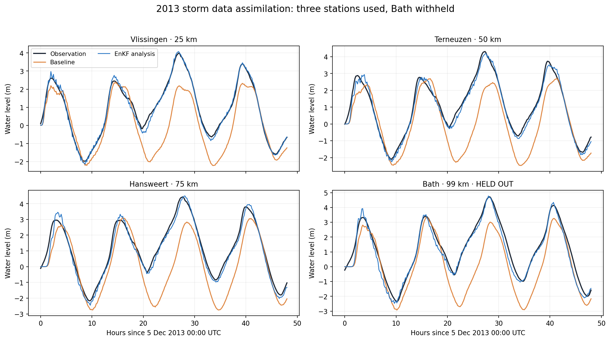
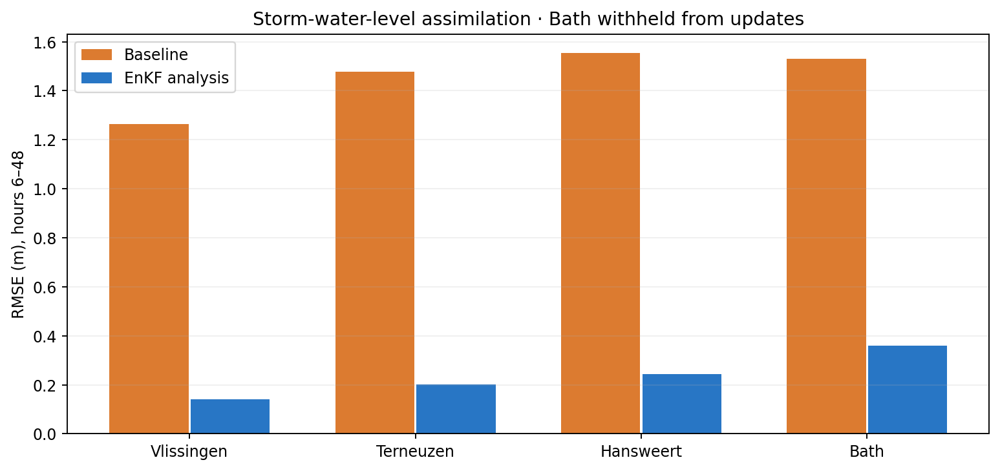
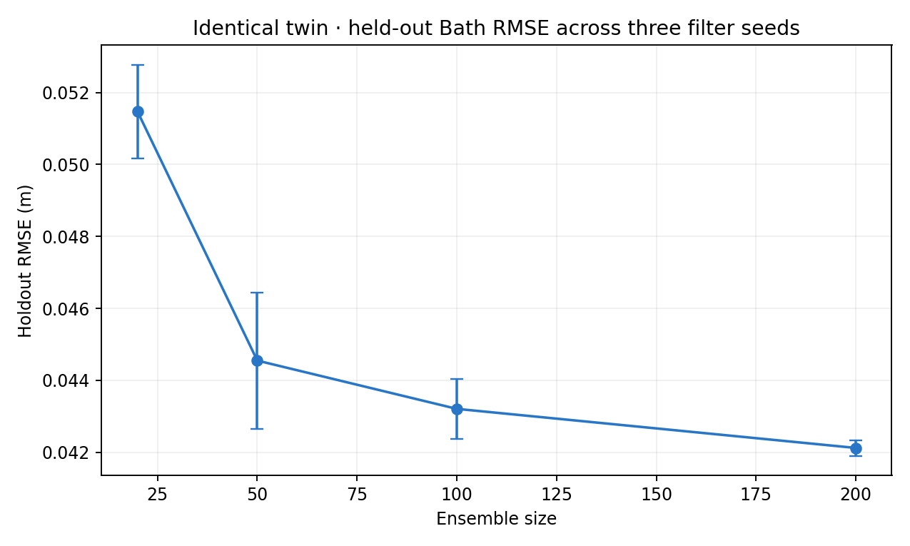

# Ensemble Kalman Filter for Tidal-Wave Data Assimilation

**Tidal wave data assimilation in Python, with [original MATLAB coursework experiments](matlab/) from the MSc Applied Mathematics at TU Delft.**

This project models propagation of water in an idealised one-dimensional estuary and applies an **Ensemble Kalman Filter (EnKF)** to combine a physical model with sparse observations. Experiments use data from the **Western Scheldt (Netherlands)** during 5–7 December 2013, including storm Xaver.

The code implements a grid solver, temporally correlated stochastic boundary forcing, an augmented state EnKF, a synthetic identical twin experiment, an ensemble size study, and tests on real observations.



## Key results

Using an ensemble of **100 members** (seed `2026`), the filter assimilates water levels at **Vlissingen, Terneuzen and Hansweert**. Observations from **Bath are held out** from the filter updates and used for evaluation. RMSE values exclude the first six hours of model spin-up.

| Station | Deterministic baseline RMSE (m) | EnKF analysis RMSE (m) | Evaluation |
|:---|---:|---:|:---|
| Vlissingen | 1.263 | 0.141 | Assimilated |
| Terneuzen | 1.477 | 0.201 | Assimilated |
| Hansweert | 1.554 | 0.243 | Assimilated |
| **Bath** | **1.530** | **0.359** | **Held out** |

At the held out Bath station, the EnKF reduces the water-level **analysis** RMSE by approximately **76.5%** compared with the deterministic baseline. This measures performance at an unassimilated location *while observations from the other stations continue to be incorporated*.



**Free forecasts are harder.** In separate tests with *no new measurements after the cutoff*, eight hour forecasts at Bath have the following RMSE:

| Last assimilation time (relative to 5 Dec 2013 00:00 UTC) | Eight-hour RMSE at Bath (m) |
|:---|---:|
| +20 hours | 2.018 |
| +24 hours | 0.616 |

These results illustrate that accurate state estimation does not automatically imply accurate long range prediction when forcing and model geometry are simplified. See `figures/06_free_forecast.png` for the corresponding traces.

### Extended validation: rolling-origin forecasts

To evaluate the forecast performance more systematically, a separate
[rolling-origin experiment](validation/README.md) evaluates nine eight-hour
forecasts starting at +8, +12, ..., +40 hours. Bath remains withheld from
the assimilation updates, and no new measurements are assimilated after
each forecast cutoff.

| Filter seed | EnKF forecast RMSE (m) | Baseline RMSE (m) | RMSE reduction |
|---|---:|---:|---:|
| 2026 | 1.123 | 1.641 | 31.5% |
| 2027 | 1.128 | 1.641 | 31.3% |
| 2028 | 1.115 | 1.641 | 32.1% |

The errors are pooled across the forecast origins, excluding observations at
the cutoff itself. The EnKF shows approximately 32% lower RMSE in this
experiment. Future astronomical tide is treated as known forcing, while
future stochastic boundary innovations have zero conditional mean.

These findings are exploratory. The forecast windows overlap, the observations
cover one storm event, and changing the filter seed does not constitute
independent environmental validation.

Reproduce the study with:

```bash
python -m experiments.rolling_forecasts --repeats 3
```

The experiment writes its detailed results to
`validation/results/rolling_forecasts.json`.

An identical-twin experiment and repeated-seed sensitivity study also assess the effect of **ensemble size (20, 50, 100, 200)**. The experiments use three filter seeds per ensemble size and should be treated as exploratory rather than as a measured asymptotic rate of convergence.



## Mathematical model

The physical model solves the linearised one-dimensional shallow-water equations

$$
\frac{\partial h}{\partial t} + D\frac{\partial u}{\partial x}=0,
\qquad
\frac{\partial u}{\partial t} + g\frac{\partial h}{\partial x}+fu=0,
$$

where $h$ is the water-level displacement, $u$ the depth-averaged flow velocity, $D$ the water depth, $g$ gravitational acceleration, and $f$ linear friction.

- **Domain:** idealised 100-km estuary, constant depth $D=20$ m
- **Spatial discretisation:** staggered grid for $h$ and $u$
- **Time discretisation:** Crank–Nicolson with sparse linear solves (SciPy)
- **Boundary conditions:** prescribed western water level and zero eastern boundary velocity
- **Theoretical frictionless wave speed:** $c=\sqrt{gD}\approx 14.007$ m/s

To model uncertainty in the western boundary level, an AR(1) process is added:

$$
\eta_{k+1}=\alpha\eta_k+w_k,
\qquad
\alpha=\exp\!\left(-\frac{\Delta t}{T}\right),
\qquad
\sigma_w=\sigma_\eta\sqrt{1-\alpha^2},
$$

with $T=6$ hours and stationary standard deviation $\sigma_\eta=0.2$ m. The filter includes the boundary error variable $\eta$ in its state, preserving a Markov representation of the correlated forcing.

At each step, the **stochastic EnKF** propagates ensemble members, estimates sample covariances, computes the gain $K=P_{xy}(P_{yy}+R)^{-1}$, and performs perturbed-observation updates. The default observation-noise standard deviation is **0.12 m**. The code separately records estimates before observation updates (*forecast/prior*) and after updates (*analysis/posterior*).

## Getting started

Requires **Python 3.10+**.

```bash
python3 -m venv .venv
source .venv/bin/activate
python -m pip install -e '.[test]'
python -m pytest -q
python -m experiments.run_all
```

On Windows PowerShell, activate the environment with `.venv\Scripts\Activate.ps1`. The experiments write `results.json` and regenerate the six figures in `figures/`.

To change the ensemble size and random seed:

```bash
python -m experiments.run_all --ensemble-size 200 --seed 1234
```

The fixed seed and data allow reproducible execution in a compatible Python environment. Numerical values can vary slightly across library versions and platforms.

## Repository layout

```text
src/tidal_enkf/
    model.py        1D shallow-water solver; staggered grid and Crank–Nicolson
    filter.py       Augmented-state stochastic Ensemble Kalman Filter
    data.py         Water-level time-series input and station locations
    metrics.py      Bias and RMSE
experiments/
    run_all.py      Baseline, twin, storm, convergence and free-forecast studies
tests/              Automated unit and numerical tests
data/               Tide-gauge observations and data provenance
figures/            Saved experiment figures
matlab/              Original MATLAB EnKF and wave-model experiments
results.json        Experiment metrics in machine-readable form
```

## MATLAB coursework experiments

The [`matlab/`](matlab/) folder preserves two MATLAB files from the original course project: an experimental Ensemble Kalman Filter and an alternative stochastic-boundary timestep. The tested Python implementation and the numerical results shown above remain unchanged.

The MATLAB experiment assimilates observations at Bath, whereas the Python experiment deliberately withholds Bath for independent evaluation. Their noise representations and numerical settings also differ and so their outputs should not be assumed equivalent. See the [MATLAB notes](matlab/README.md) for details and dependencies.

## Scope and limitations

The model is deliberately idealised: one spatial dimension, fixed water depth, simplified geometry and boundary conditions. Boundary and measurement uncertainty settings are exploratory values rather than calibrated estimates for this storm. Three assimilated stations and one spatial holdout provide a useful demonstration, but broader validation would require other periods and stations. The convergence experiment uses only three random seeds per ensemble size.

## Project context and data credits

The work originated as a MATLAB project for **WI4475 Data Assimilation** in the MSc Applied Mathematics programme at **Delft University of Technology (TU Delft)**, based on the course assignment. This repository presents the numerical modelling, filtering and evaluation in Python.

The observation series were distributed for the course and identify **MATROOS** as the series database. The underlying Dutch water-level observations are attributed to **Rijkswaterstaat**. Public Rijkswaterstaat Waterinfo data are listed as public-domain/CC0; see the [official dataset catalogue](https://data.overheid.nl/dataset/9442-waterinfo-rijkswateren) and [Waterinfo reuse terms](https://waterinfo-extra.rws.nl/monitoring/gebruik-data/). See [`data/README.md`](data/README.md) for information about the specific extracts in this repository.

The code, figures and metrics in this repository describe the **Python experiments reported here**.
